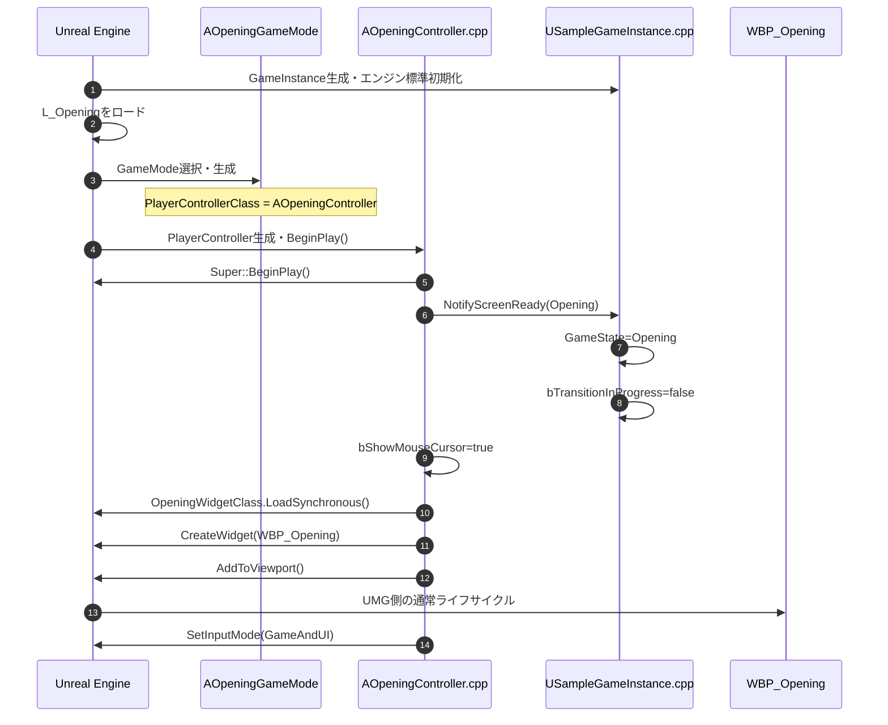
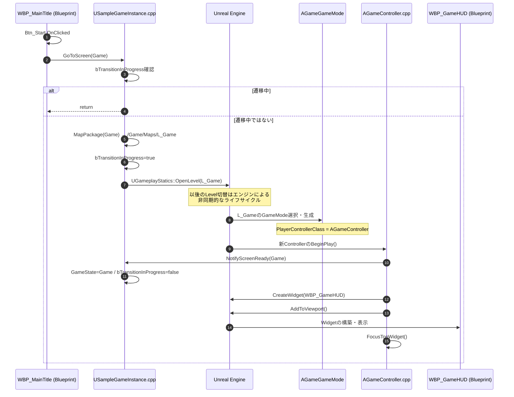
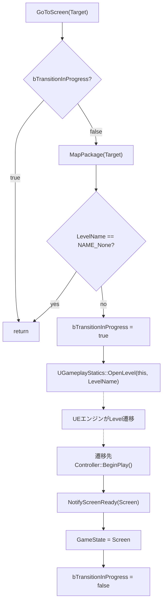
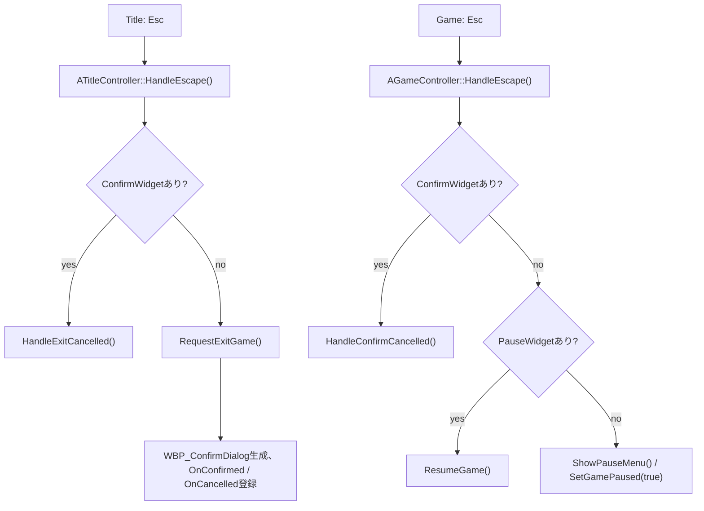
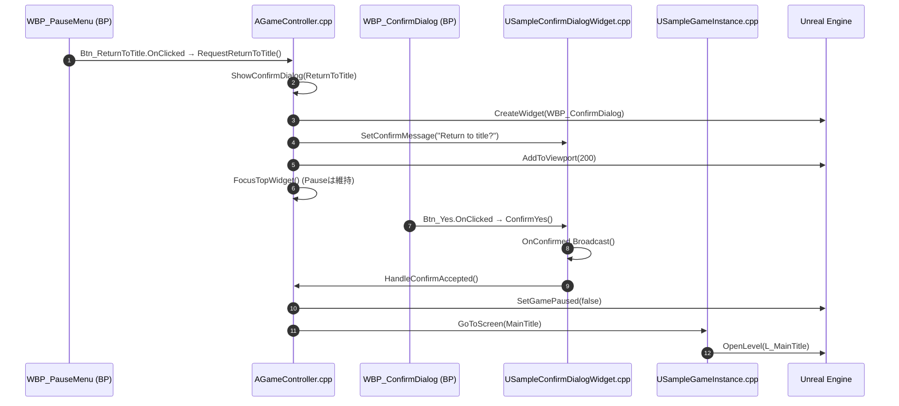

# CALL_FLOW: Blueprint版と等価なC++画面遷移

この文書は、[元のBlueprint版の仕様書](https://github.com/mrtksHub/codex_ue_sample/blob/main/docs/BLUEPRINT_SPEC.md)と本リポジトリのC++コードを突き合わせて、**エンジンが起動するイベント、C++の直接呼び出し、Widget Blueprintのイベント**を区別したものです。

- **設計基準**: `Opening → MainTitle → Game → Ending → Opening`。GameのPauseメニューからはMainTitleへ戻れる。
- **実装方針**: 4つのControllerは独立した`APlayerController`の子クラス。画面ごとのGameModeがそれぞれを指定する。
- **確認範囲**: C++ソースの静的照合。元の`.uasset`の全ノード比較、UE 5.8ビルドと実行トレースは未実施。
- Mermaidの`UE -> Controller.BeginPlay`などはエンジンによるイベント呼び出しであり、`OpenLevel`から同期的にBeginPlayが呼ばれることを意味しない。

## 1. クラスとファイルの一対一対応

| 元のBlueprint | C++クラス・主な関数 | ソース |
| --- | --- | --- |
| `BP_GameInstance` | `USampleGameInstance::GoToScreen` / `NotifyScreenReady` / `MapPackage` | [SampleGameInstance.cpp](../Source/ScreenFlow/Private/SampleGameInstance.cpp) |
| `BP_GameModeBase`と4子BP | `ASampleGameModeBase`と`AOpeningGameMode` / `AMainTitleGameMode` / `AGameGameMode` / `AEndingGameMode`の各コンストラクター | [SampleGameMode.cpp](../Source/ScreenFlow/Private/SampleGameMode.cpp) |
| `BP_OpeningController` | `AOpeningController::BeginPlay` / `SetupInputComponent` / `HandleAnyKey` / `EndPlay` | [OpeningController.cpp](../Source/ScreenFlow/Private/OpeningController.cpp) |
| `BP_TitleController` | `ATitleController::BeginPlay` / `SetupInputComponent` / `RequestExitGame` / `HandleEscape` / `HandleExitConfirmed` / `HandleExitCancelled` / `FocusTopWidget` / `EndPlay` | [TitleController.cpp](../Source/ScreenFlow/Private/TitleController.cpp) |
| `BP_GameController` | `AGameController::BeginPlay` / `SetupInputComponent` / `HandleEscape` / `ShowPauseMenu` / `ResumeGame` / `ShowConfirmDialog` / `HandleConfirmAccepted` / `HandleConfirmCancelled` / `FocusTopWidget` / `EndPlay` | [GameController.cpp](../Source/ScreenFlow/Private/GameController.cpp) |
| `BP_EndingController` | `AEndingController::BeginPlay` / `EndPlay` | [EndingController.cpp](../Source/ScreenFlow/Private/EndingController.cpp) |
| `WBP_ConfirmDialog`のイベントDispatcher | `USampleConfirmDialogWidget::ConfirmYes` / `ConfirmNo` / `SetConfirmMessage` | [SampleConfirmDialogWidget.cpp](../Source/ScreenFlow/Private/SampleConfirmDialogWidget.cpp) |
| `E_ScreenState` / 構造体 | `ESampleScreen` / `FSamplePlayerData` / `FSampleSettings` / `FSampleSaveData` | [SampleTypes.h](../Source/ScreenFlow/Public/SampleTypes.h) |

`SamplePlayerController`と`SampleScreenWidget`は旧C++案から削除済み。`StartGame`、`ClearGame`、`FinishEnding`というC++関数も**現構成には存在しない**。これらのボタンは、元のBP版と同様、WBPの`OnClicked`から直接`GameInstance.GoToScreen`へつなぐ。

## 2. UE起動 → Opening画面構築

`DefaultEngine.ini`の`GameInstanceClass=/Script/ScreenFlow.SampleGameInstance`および各MapのGameMode設定を使用する。`USampleGameInstance`には独自`Init()`オーバーライドはなく、GameInstance自体の生成・初期化はエンジン担当。

`AOpeningGameMode`のコンストラクターは`PlayerControllerClass = AOpeningController::StaticClass()`を指定する。他の3 Mapもそれぞれ異なるControllerを指定する。

各Controllerの`SetupInputComponent()`では`Super::SetupInputComponent()`に続いて、OpeningのAnyKey、Title/GameのEscape入力を個別登録する。UEの入力初期化経路から呼ばれるもので、`BeginPlay()`の内部で`SetupInputComponent()`を直接呼んでいるわけではない。

## 3. MainTitleのStart → Game

ボタンの`OnClicked`はWBPのグラフで実装し、C++へ自動バインドしない。

Title → Game以外の画面切替も、呼び出し元WBPと`Target`を変えるだけ。

| 開始操作（Blueprintまたは入力） | 直接呼び出す関数 | Target |
| --- | --- | --- |
| OpeningでAny Key | `AOpeningController::HandleAnyKey()` → `GoToScreen` | MainTitle |
| MainTitleの`Btn_Start.OnClicked` | `USampleGameInstance::GoToScreen` | Game |
| Gameの`Btn_GameClear.OnClicked` | `USampleGameInstance::GoToScreen` | Ending |
| Endingの`Btn_Finish.OnClicked` | `USampleGameInstance::GoToScreen` | **Opening** |
| PauseのReturn to Title確認Yes | `AGameController::HandleConfirmAccepted` → `GoToScreen` | MainTitle |

## 4. GoToScreenとNotifyScreenReadyの処理フロー

この処理は[SampleGameInstance.cpp](../Source/ScreenFlow/Private/SampleGameInstance.cpp)に対応する。元BP同様、`GoToScreen`で「遷移元から遷移先へ進めるか」の追加許可表やMapファイル存在チェックは行わない。

`NotifyScreenReady`は各Controllerの`BeginPlay`から呼び出す。`OpenLevel`の失敗時のロック解除や`TravelFailure`購読は追加していないため、存在しないMapなどに遷移した場合の復元は保証していない。これは改善すべき余地ではあるものの、今回の既存BP等価移植の範囲外。

## 5. Esc → Pause → Confirm のフロー

TitleとGameで**別々のController**が入力を処理する。

GameのEscapeバインディングは`SetupInputComponent()`内で`bExecuteWhenPaused=true`に設定する。**Confirm → Pause → Game**の優先順位は`HandleEscape`内の`return`で保証する。

### PauseのReturn to TitleでYesを押した場合

Noボタンは`WBP_ConfirmDialog`の`OnClicked`から`USampleConfirmDialogWidget::ConfirmNo()`を呼ぶ。そこから`OnCancelled.Broadcast()`を経て、Titleでは`ATitleController::HandleExitCancelled()`、Gameでは`AGameController::HandleConfirmCancelled()`が呼ばれる。Game側のCancelではPauseは解除しない。

Exit GameのYesでは`UKismetSystemLibrary::QuitGame()`を呼ぶ。TitleのExitとPauseからのExitで解除処理は異なるため、実装ファイルをそれぞれ確認すること。

## 6. BPに残す処理とC++が保持するデータ

各WBPの`OnClicked`は**Blueprintで作る**。C++の`BeginPlay`はWidgetの生成・表示と入力設定を担当するが、元の`Btn_Start`等のクリックイベントをC++で登録しない。WBP/Mapはまだリポジトリに含まれていない。

| WBP | ボタンのBlueprintイベント | C++の受け口 |
| --- | --- | --- |
| WBP_MainTitle | `Btn_Start.OnClicked` | `USampleGameInstance::GoToScreen(Game)` |
| WBP_MainTitle | `Btn_ExitGame.OnClicked` | `ATitleController::RequestExitGame()` |
| WBP_GameHUD | `Btn_GameClear.OnClicked` | `USampleGameInstance::GoToScreen(Ending)` |
| WBP_Ending | `Btn_Finish.OnClicked` | `USampleGameInstance::GoToScreen(Opening)` |
| WBP_PauseMenu | `Btn_Resume.OnClicked` | `AGameController::ResumeGame()` |
| WBP_PauseMenu | `Btn_ReturnToTitle.OnClicked` | `AGameController::RequestReturnToTitle()` |
| WBP_PauseMenu | `Btn_ExitGame.OnClicked` | `AGameController::RequestQuitGame()` |
| WBP_ConfirmDialog | `Btn_Yes.OnClicked` / `Btn_No.OnClicked` | `USampleConfirmDialogWidget::ConfirmYes()` / `ConfirmNo()` |

`USampleGameInstance`の`GameState`、`CurrentChapter`、`PlayerData`、`Settings`、`SaveData`は`UPROPERTY`としてBPへ公開済み。今回の等価版には`SetCurrentChapter`、`OnDataChanged`、`OnModelChanged`、自動Text更新の経路は**ない**。BPは必要なタイミングでプロパティを取得して表示に反映する。`CurrentChapter`自体は元のBPの将来拡張用の変数であり、現サンプルにチャプター進行機能はない。

## 7. 確認が必要な点

- `WBP_ConfirmDialog`のみ、C++の`USampleConfirmDialogWidget`を親にする。既存BPの同名Dispatcherを削除して新しい親のDispatcherにつなぎ直すこと。
- 各WBPの`GetOwningPlayer`がそれぞれ対応するControllerを返すよう、正しいGameModeを各Mapで選択すること。
- `SetupInputComponent`はエンジンが入力を初期化する際に呼び出す。`BeginPlay`の中に手動で挿入しないこと。
- UI Focus中のEscやOpeningのAny Key、Widgetのクリック優先順位は**StandaloneとPIEで要実測**。現コードは旧C++案の`NativeOnPreviewKeyDown`によるキー消費を引き継いでいない。
- ビルド前・実行前なので、**「完全等価」を実測済みとは主張しない**。受け入れ条件は[VALIDATION.md](VALIDATION.md)に従う。

関連資料: [ARCHITECTURE.md](ARCHITECTURE.md) / [EDITOR_SETUP.md](EDITOR_SETUP.md) / [VALIDATION.md](VALIDATION.md)。
