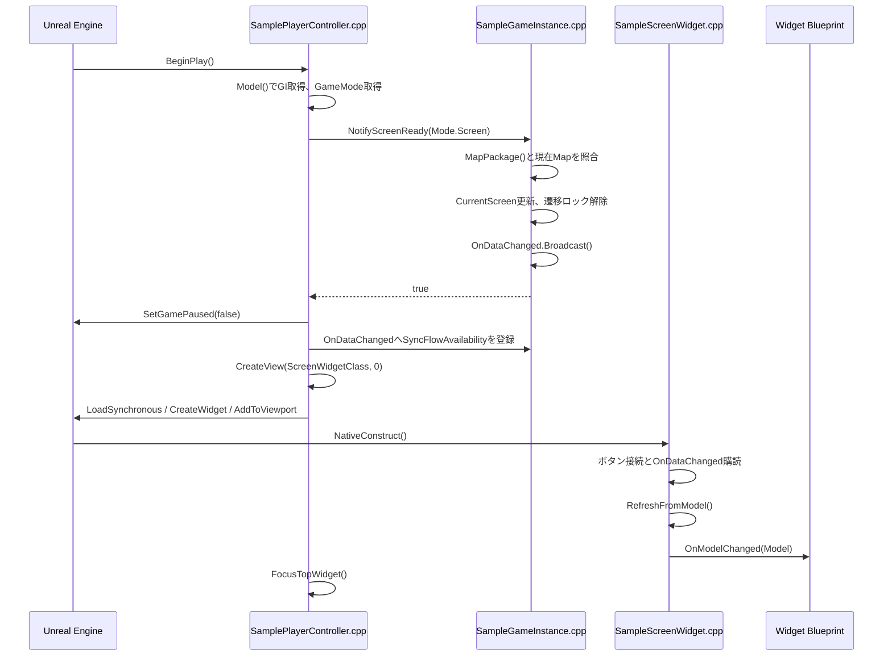
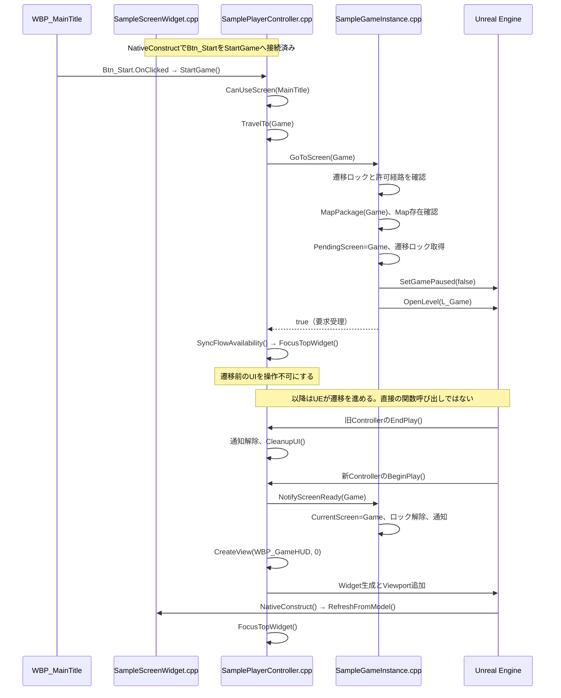
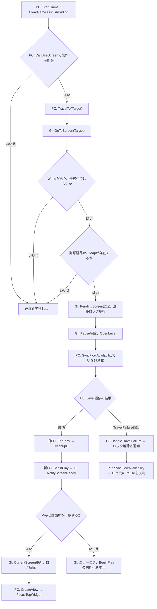
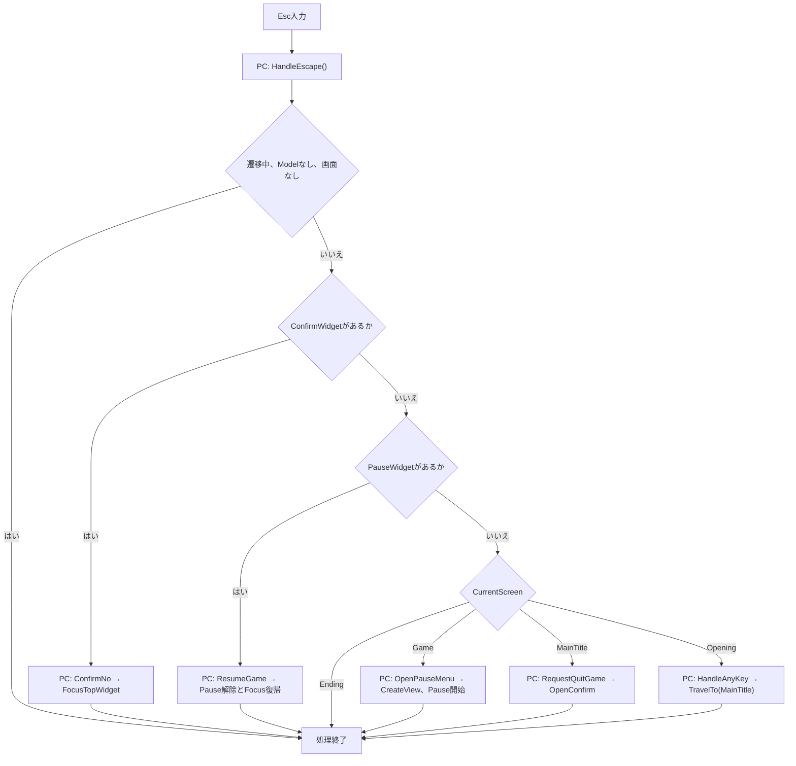
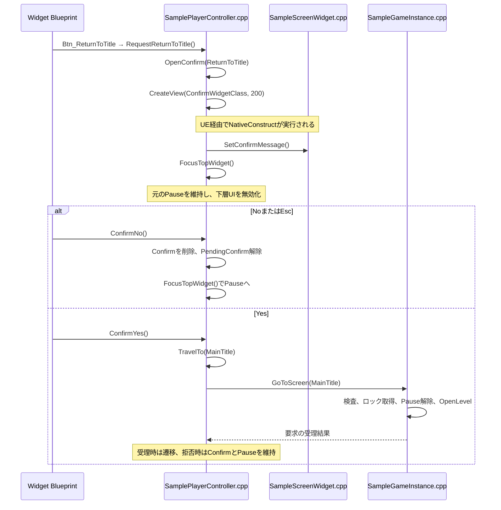
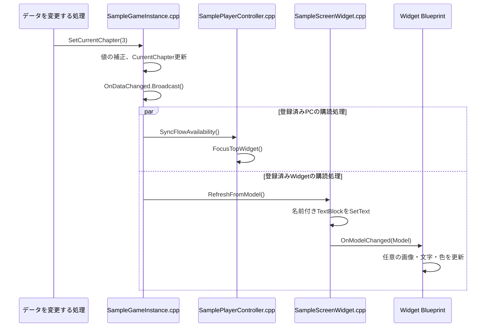

# コールフローと処理フロー

この図は登録済みC++ソースの静的な読み取りに基づきます。UEでの実行トレースではありません。
MapとWidget BlueprintはEditorで作成する必要があります。

## ソースと略号

| 略号 | ソース | クラスと役割 |
| --- | --- | --- |
| GI | [SampleGameInstance.cpp](../Source/ScreenFlow/Private/SampleGameInstance.cpp) | USampleGameInstance: 状態、遷移、共通データ |
| PC | [SamplePlayerController.cpp](../Source/ScreenFlow/Private/SamplePlayerController.cpp) | ASamplePlayerController: 入力、画面生成、Pauseと確認 |
| W | [SampleScreenWidget.cpp](../Source/ScreenFlow/Private/SampleScreenWidget.cpp) | USampleScreenWidget: ボタン接続、表示更新 |
| GM | [SampleGameMode.cpp](../Source/ScreenFlow/Private/SampleGameMode.cpp) | ASampleGameModeと4子クラス: 画面構成 |
| 型 | [SampleTypes.h](../Source/ScreenFlow/Public/SampleTypes.h) | 画面・確認Enum、データStruct |
| BP | Editorで作成するWBP_* | 見た目とOnModelChangedの表示処理 |
| UE | Unreal Engine | Level遷移、ライフサイクル、Widget構築 |

図のPC / GI / Wは上表のソースを表します。UE経由の呼び出しはC++からの直接呼び出しと区別します。
OpenLevelは遷移を要求します。呼び出した場所から次のBeginPlayへ直ちに関数呼び出しが続くわけではありません。

## 1. 起動と画面構築

GameInstanceはInitでTravelFailure通知を購読し、Shutdownで解除します。
画面とWidgetの組み合わせはGMの各コンストラクターで指定済みです。
SetupInputComponentでEsc / AnyKeyを接続します。以下の図はLevel開始後の画面構築の順序です。

NotifyScreenReadyの通知時点では、新しい画面のWはまだ購読していません。
そのためNativeConstructでRefreshFromModelを明示的に呼び、初期値を表示します。
この一度の初期更新が、最初の表示を成立させます。

## 2. Startを押した場合のコールフロー

OnClickedの接続先はPCです。クリックのたびにWの中継関数を呼ぶ構造ではありません。
Wは構築時に接続を準備します。新旧PCは同じクラスですが別インスタンスです。

## 3. 画面遷移の処理フロー

Map/GameMode不一致は設定エラーです。自動修復する処理はありません。
TravelFailureは当該GameInstanceのWorldからの通知を処理します。全てのロード障害に対する復帰を保証するものではありません。
GoToScreenの許可経路チェックと、PCのUI操作可否チェックは別です。通常のUI操作はPCのコマンドから呼びます。

## 4. Escの処理フロー

UIにFocusがある場合はWのNativeOnPreviewKeyDownからPCのHandleUIKeyを呼びます。
Focusがない場合はPCのSetupInputComponentで登録したEscバインドがHandleEscapeを呼びます。
UIで処理済みのキーはFReply::Handledで消費し、リピートによる再操作も抑えます。

いずれか1つの操作をしたらreturnします。Confirmから同じEscでGameまで戻りません。

## 5. Pauseからタイトルへ戻るコールフロー

以下はPauseが開いている状態からです。各ボタンはWのNativeConstructでPCの対応関数へ接続済みです。

終了確認のYesはConfirmYesのQuitGame分岐です。
Pause解除 → ConfirmNo → 必要ならResumeGame → UKismetSystemLibrary::QuitGameの順に実行します。
No / EscではQuitGameを呼びません。

## 6. 管理データからBlueprint表示へのコールフロー

parは同じ通知に複数の購読先があることを示します。別スレッドで並列実行する意味ではありません。
購読先の実行順に依存した表示処理は作らないでください。
SetPlayerData / SetSettingsも同じ通知経路です。
OnModelChangedは表示を更新するためのイベントです。この中で同じSetterを呼び続けると通知が再帰します。

## 7. ボタンと呼び出し先

接続コードはすべてWのNativeConstructにあります。PCのコマンドが管理処理の入口です。

| Widget | Button | PCの関数 | 結果 |
| --- | --- | --- | --- |
| WBP_MainTitle | Btn_Start | StartGame | Gameへ |
| WBP_MainTitle | Btn_ExitGame | RequestQuitGame | 終了確認 |
| WBP_GameHUD | Btn_GameClear | ClearGame | Endingへ |
| WBP_Ending | Btn_Finish | FinishEnding | MainTitleへ |
| WBP_PauseMenu | Btn_Resume | ResumeGame | 再開 |
| WBP_PauseMenu | Btn_ReturnToTitle | RequestReturnToTitle | タイトル復帰確認 |
| WBP_PauseMenu | Btn_ExitGame | RequestQuitGame | 終了確認 |
| WBP_ConfirmDialog | Btn_Yes | ConfirmYes | 確認内容を実行 |
| WBP_ConfirmDialog | Btn_No | ConfirmNo | 確認だけ閉じる |

Opening → MainTitleの入口はHandleAnyKeyです。
ゲーム開始、クリア、Ending終了はそれぞれStartGame / ClearGame / FinishEndingですが、
TravelTo以降の遷移手順は共通です。

## 読む順序

1. PCのStartGame / CanUseScreen / TravelTo。
2. GIのGoToScreen / MapPackage / NotifyScreenReady。
3. PCのBeginPlay / CreateView / EndPlay / CleanupUI。
4. WのNativeConstruct / RefreshFromModel。
5. PCのHandleEscape / OpenPauseMenu / OpenConfirm / ConfirmYes / ConfirmNo。

この順で読むと、操作、遷移、画面構築、表示更新、補助UIの順に理解できます。
